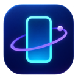

# OrbitSim



OrbitSim is an independent macOS workbench for iOS Simulator and paired-device testing. It is under early development and does **not** yet match RocketSim Pro. The [feature matrix](docs/feature-matrix.md) is the completion contract.

## Current capabilities

- Native SwiftUI window and menu bar entry point.
- The `orbitsim` CLI is built into the macOS app at `Contents/SharedSupport/orbitsim`. Release Settings can install a safe link in `~/.local/bin`; Debug builds keep that button disabled. The app and CLI report the same version, with a bundle check in CI.
- Compact Side Tools window follows an explicitly selected Device Hub target window. Its initial attachment was verified on the iPhone 17 Pro Simulator; move, resize, and disconnect behavior is still being tested.
- Live Device Hub window preview for a selected Simulator or connected device, with an explicit window picker. The native stream was verified on both target types; it stops if Device Hub switches targets. This is a host-window preview, and physical scale modes remain incomplete.
- Discover installed Simulators and paired devices by stable ID.
- Capture a PNG from a booted Simulator through the CLI or native Save panel (verified on iPhone 17 Pro, iOS 26.4.1).
- Show a floating preview after a successful native screenshot, with drag, Copy Image, and Reveal in Finder actions. Copy Image and Reveal in Finder were checked on the fixture Simulator; drag and paste into another app still need live checks.
- Export Simulator screenshots as PNG, JPEG, TIFF, or BMP. All four types were verified at 1206×2622 on the fixture Simulator.
- Record a bounded MP4 from a booted Simulator through the CLI or native Save panel. A two-second CLI request produced 1.58 seconds of video; a 10-second native request produced a valid 9.67-second video track. Startup time is excluded from the recorded footage.
- Export a bounded animated GIF from a selected Simulator through the CLI or native app. A fixture action changed during a 39-frame, 10 FPS GIF; physical-device GIFs and post-editing are pending.
- CLI adapters for Simulator boot, shutdown, appearance, location, app install/launch/terminate, media, push, privacy, status bar, and display enumeration. Most actions are built but still need integration verification.
- Simulator routes accept explicit waypoints and speed in the CLI and native app. A CLI route moved the iPhone 17 Pro fixture app through multiple location updates and was cleared afterward; the native route control still needs a live UI check.
- Physical-device PNG screenshot through `devicectl`, verified through both CLI and native Save panel on a paired iPhone. The rebuilt native app saved the screenshot with private 0600 permissions. App install/launch and URL actions still need device checks; `devicectl` screen recording was unsupported on this phone.
- Structured Simulator display enumeration with explicit display selection for multi-screen captures. Both integrated iPhone Duo screens were captured by the CLI; fold-state rendering remains incomplete.
- Visible Simulator accessibility identifiers, screen-coordinate frames, press, type, and wait through Device Hub's macOS Accessibility bridge. Verified on the included iOS fixture app; text is omitted from CLI output unless `--include-text` is requested. This path needs Accessibility permission and a uniquely matched visible Simulator window. The Xcode 27.2 screen-container guard excludes Device Hub controls; highlighting and broader app coverage are pending.
- Read-only build statistics from Xcode build log manifests, available through `orbitsim builds` and a native Build Insights window. The app retains a bounded local SQLite history in WAL mode; CLI users can opt into that cache with `orbitsim builds --history`. Detailed build-step analysis is pending.

## Requirements

Apple silicon, macOS 27, and Xcode 27.2. Xcode command-line tools must point to the intended Xcode installation. The project is Apache 2.0 licensed.

## Build and test

```sh
swift build
swift test
xcodebuild -project OrbitSim.xcodeproj -scheme OrbitSim -configuration Debug -destination 'platform=macOS' -derivedDataPath DerivedData CODE_SIGNING_ALLOWED=NO build
```

Run `./.build/debug/orbitsim help` for CLI usage, or run the CLI from the built app at `DerivedData/Build/Products/Debug/OrbitSim.app/Contents/SharedSupport/orbitsim`. Mutating commands require a specific target ID from `orbitsim targets`; OrbitSim deliberately never chooses an arbitrary booted Simulator. The Xcode project uses the Xcode 27 JSON `.xcproj` format. Do not run XcodeGen on it.

`OrbitFixture` is an included iOS Simulator test app with stable accessibility identifiers and a `orbitsimfixture://` URL scheme. Build it with the `OrbitFixture` Xcode scheme, then use it to test lifecycle, links, and agent commands on a disposable Simulator.

## Development boundaries

The app and CLI are original code and use Apple tools and frameworks. Research about another product stays outside this repository. Sparkle is integrated into Release builds and its signing key has been generated, but the feed and two-version update drill are pending; no update channel is live yet. See the [release process](docs/release-process.md). No release or full-parity claim should be made until every supported individual feature passes its acceptance test in the matrix.

## License

Apache License 2.0. See [LICENSE](LICENSE) and [NOTICE](NOTICE).
